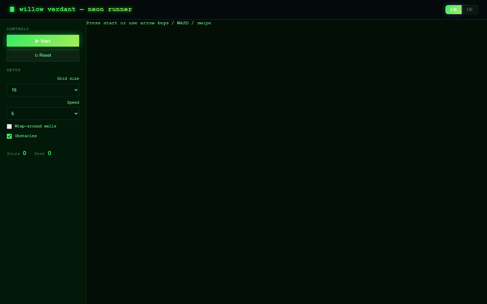
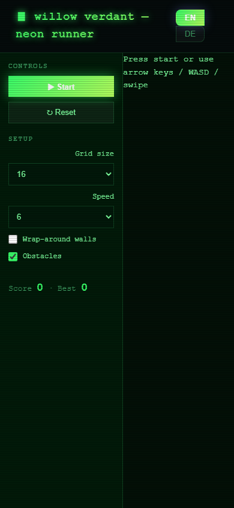

# Willow Verdant — Neon Runner

A neon snake runner on a 16×16 grid at 8 ticks/s, plus 6 obstacles. Keyboard, touch and score persistence included.

<div align="center">


**[Live Demo](https://ruslanfridenli.github.io/willow-verdant/)** · **[Deutsch ↓](#-deutsch)**

</div>

---

## Screenshots






## Features

- 16×16 grid gameplay
- Variable speed and wrap-around mode
- 6 obstacles for extra challenge
- Keyboard (arrows/WASD) and touch swipe controls
- Persistent best score via localStorage
- English/German interface

## Local development

```bash
git clone https://github.com/ruslanfridenli/willow-verdant.git
cd willow-verdant
# open index.html in a browser, or serve statically:
npx serve .
```

No build step, no dependencies — pure static site.

---

## 🇩🇪 Deutsch

### Willow Verdant — Neon Runner

Ein Neon-Snake-Runner auf einem 16×16 Gitter mit 8 Schritten/s, plus 6 Hindernissen. Tastatur, Touch und Punktespeicherung inklusive.

### Funktionen

- 16×16 Gitter-Gameplay
- Variable Geschwindigkeit und Umlaufmodus
- 6 Hindernisse für mehr Herausforderung
- Tastatur (Pfeile/WASD) und Touch-Wischen
- Punkterekord via localStorage
- Englische/deutsche Oberfläche

### Lokale Entwicklung

```bash
git clone https://github.com/ruslanfridenli/willow-verdant.git
cd willow-verdant
npx serve .
```

Reine statische Seite — kein Build-Schritt, keine Abhängigkeiten.

---

## ☕ Support / Unterstützen

Wenn dir diese Website beim Lernen hilft, würde mir eine Spende sehr viel bedeuten und dabei helfen, sie weiterzuentwickeln. Alternativ kannst du das Projekt mit einem Stern im github repo unterstützen. Vielen Dank!

- Solana: `zQpgZ6nGigww7vYpz3Qqxb1BT44kqS567vFaLTeHagS`
- Ethereum: `0x9c4fE1B2e9a1A9c22312c8296BB088Ca0e8F1B4e`
- Bitcoin: `bc1p2jltk9ya9kyzv35d8kxn7mmg9jqkx66cqtgzqwe75zlr4v9jk4hsv468q7`

---

Made with care. Feedback welcome via issues.
